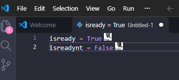

# Python Bool Icons

A Visual Studio Code extension that decorates Boolean variables in Python with Morgan Freeman. It is also compatible with JupyterLab (tried and true baby).

## Features

- Displays a magnificent icon for Python Boolean variables (`True` and `False`).
- Works in Python source files and JupyterLab notebooks and maybe something else.

## Screenshot

